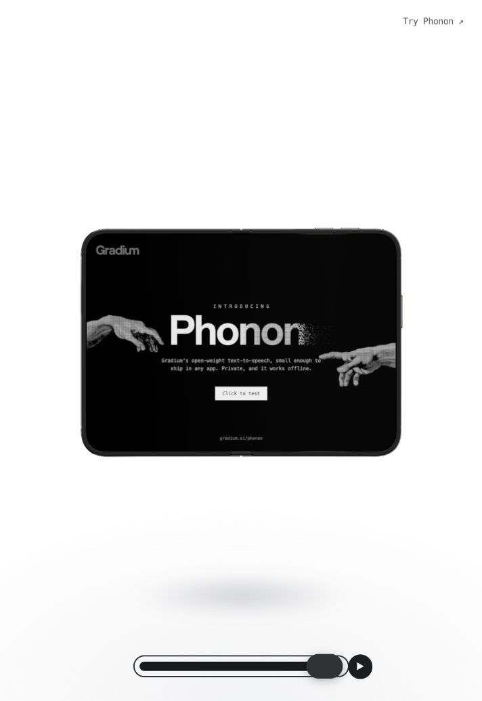

# One More Fold

[Phonon](https://gradium.ai/phonon), folded into an iPhone Duo demo.



```bash
bun install
bun run start
```

Open http://127.0.0.1:4323/?enhanced=&enhanced-rt=.

The phone opens and closes once silently. Press Space or Play to hear a keynote-style line generated by Phonon in your browser. Press again to stop. Dragging the slider or phone also stops speech. Reduced motion keeps the phone still during narration.

Phonon 31m downloads from Hugging Face on first play and caches its model in the browser. Speech runs locally in a worker, with no API key or speech server. It uses “One More Fold,” our selected Gradium Voice Design voice, bundled in `assets/keynote-voice.safetensors`. The first play can take a while; loading progress appears above the controls. Use a browser with WebAssembly SIMD over HTTPS or localhost. Integration follows the [official browser guide](https://github.com/gradium-ai/xn-ptts/tree/main/ptts-wasm/js).

This is a recording prototype, not an official Apple product page. Both displays show compositions of the Phonon landing page using its original hands and wordmark. The pictured “Click to test” button is part of the screen artwork; use Play for speech. The phone viewer loads additional assets from Apple, so an internet connection is required.

`hero-screens.js` draws the two screen textures. `/halo-preview.html` shows them at full size. Run `bun run check` and `bun run build` before opening a PR.

The hands reproduce Michelangelo’s *Creazione di Adamo*, c. 1511, in the Sistine Chapel, Musei Vaticani. Artwork details are on the [Phonon page](https://gradium.ai/phonon).

Apple viewer code and imagery, and Gradium branding, remain the property of their respective owners. No blanket open-source license is granted for those assets.
